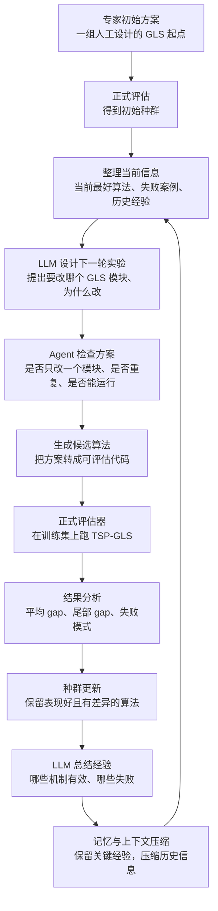

# 简化版框架工作流说明（给导师汇报用）

> 这一版只用于汇报，不讲代码实现细节。  
> 注意：下面的“五模块 GLS 设计方案”只是汇报用临时说法，代码里当前叫 `ARCH_SPEC`，正式论文命名后面再定。

---

## 1. 一句话说明当前框架

我们的框架不是让 LLM 直接写一个启发式函数，而是让 LLM 像算法专家一样，每一轮提出一组 GLS 算法改进方案；Agent 负责检查这些方案是否合理，然后交给正式评估器验证效果，最后把结果总结成经验，进入下一轮。

简单说就是：

```text
LLM 提方案，Agent 把关，Evaluator 做实验，Memory 记经验，下一轮继续改。
```

---

## 2. 总体工作流图



如果 PPT 不方便放 mermaid，可以用下面这个简化图：

```text
专家初始方案
     ↓
正式评估，得到初始种群
     ↓
整理当前信息：最好算法 / 失败案例 / 历史经验
     ↓
LLM 设计下一轮实验
     ↓
Agent 检查方案是否合法
     ↓
生成候选算法并正式评估
     ↓
分析结果：平均性能 / 尾部风险 / 失败模式
     ↓
更新种群
     ↓
LLM 总结经验
     ↓
记忆与上下文压缩
     ↓
进入下一轮
```

---

## 3. LLM 在里面做什么？

LLM 主要做两件事。

### 3.1 第一件事：提出下一轮实验方案

每一轮开始时，LLM 会看到：

```text
当前哪些算法最好；
哪些算法失败了；
过去总结出哪些经验；
当前种群是否集中在某一类机制上。
```

然后 LLM 提出下一轮要测试的算法改动。

例如它会提出：

```text
这轮重点测试 penalty 的 top_k；
或者测试 restart 是否应该采用 penalty decay；
或者测试停滞时是否应该增强距离更新强度。
```

也就是说，LLM 的角色不是“随便写代码”，而是“提出实验假设”。

---

### 3.2 第二件事：每轮结束后总结经验

每轮实验结束后，LLM 会根据结果总结：

```text
哪些设计有效；
哪些设计失败；
哪些失败模式反复出现；
下一轮应该继续尝试什么；
哪些方向不要再重复。
```

这相当于专家做完实验后的实验笔记。

---

## 4. Agent 在里面做什么？

Agent 的作用是防止 LLM 的想法变成不可控实验。

它主要做三类事情。

### 4.1 检查方案是否合法

LLM 提出的每个候选都必须说明：

```text
从哪个父代算法改来；
改的是哪个 GLS 模块；
为什么这样改；
预期会改善什么。
```

Agent 会检查：

```text
是不是只改了一个模块；
是不是重复已有方案；
是不是能转成可运行代码；
是不是符合评估接口。
```

如果不合法，就拒绝，不会偷偷用默认方案替代。

---

### 4.2 把方案转成候选算法

LLM 输出的是算法设计方案，Agent 把它转换成可以运行的候选代码。

这样做的好处是：

```text
LLM 不直接写任意代码；
候选算法更稳定；
每个改动更容易解释；
实验结果更容易归因。
```

---

### 4.3 控制实验流程

Agent 还负责：

```text
调用评估器；
记录每个候选的结果；
保存失败原因；
更新种群；
触发经验总结和上下文压缩。
```

所以可以这样说：

```text
LLM 负责想，Agent 负责管，Evaluator 负责验证。
```

---

## 5. 我们现在让算法改哪些 GLS 模块？为什么是这几个？

这里先不要把名字定死。汇报时可以暂时说：

```text
我们把 GLS 拆成几个可设计环节，目前只开放其中 5 个高价值环节给 LLM 改。
```

代码里现在叫 `ARCH_SPEC`，但论文里最终叫什么还可以再讨论。

---

### 5.1 一个完整 GLS 流程里，理论上有哪些地方可以设计？

GLS 不是只有一个“距离更新公式”。一个完整 TSP-GLS 求解流程里，其实很多地方都可以设计。

| GLS 流程位置 | 可以设计什么 | 对算法的影响 | 当前是否开放给 LLM |
|---|---|---|---|
| 问题输入与距离表示 | 坐标如何转距离、距离是否归一化、是否加入额外边特征 | 影响所有后续搜索行为，但会改变问题表示，容易让对比不公平 | 暂不开放 |
| 初始解构造 | 最近邻、随机插入、多起点、贪心修正等 | 影响搜索起点，可能显著影响结果，但和 GLS 主体机制混在一起后难以归因 | 暂不开放 |
| 邻域结构 | 用哪些邻域，例如 2-opt、relocate、swap，候选邻居数量多少 | 直接决定局部搜索能力和运行时间，是底层求解器核心 | 暂不开放 |
| 局部搜索策略 | first improvement / best improvement，邻域扫描顺序，是否限制候选边 | 影响速度和局部最优质量，但实现复杂，容易引入运行时间差异 | 暂不开放 |
| 距离/代价更新 | 如何根据边长、使用次数、utility、penalty 状态构造引导距离 | 这是 GLS 引导搜索的核心，直接影响哪些边被认为“不应该继续走” | 已开放 |
| 惩罚边选择 | 当前局部最优 tour 上，哪些边被加 penalty，加多少，是否衰减 | 决定 GLS 如何逃离当前局部最优，是 penalty 机制的核心 | 已开放 |
| 扰动/逃逸 | 局部搜索后如何扰动，扰动几步，何时加强扰动 | 决定搜索能否跳出局部最优，影响探索能力 | 已开放 |
| 重启/恢复 | 停滞后回到 best、回到初始解、重建解、衰减 penalty 等 | 决定搜索长期停滞时如何恢复，影响稳定性 | 已开放 |
| 强度调度 | 不同迭代阶段、不同实例规模、停滞状态下是否改变 penalty 强度 | 决定算法是否能自适应不同搜索阶段 | 已开放 |
| 接受与 best 更新 | 什么解可以作为当前解，如何更新 best，是否接受劣解 | 影响搜索轨迹，但如果开放会接近重新设计整个 metaheuristic | 暂不开放 |
| 停止条件 | 最大迭代、时间限制、停滞轮数、目标阈值 | 直接影响计算预算。为了公平对比必须固定 | 暂不开放 |
| 实例自适应调度 | 根据城市数、边长分布、搜索停滞程度自动切换策略 | 很有潜力，但如果完全开放会扩大搜索空间，当前只在强度调度和扰动里保留一部分 | 部分开放 |

所以，完整 GLS 里可以设计的地方很多。我们当前不是说“GLS 只有 5 个模块”，而是说：

```text
完整 GLS 有很多可设计环节；
当前版本先开放其中最接近启发式设计、最容易审计、最不破坏公平对比的 5 个环节。
```

---

### 5.2 为什么当前选择这 5 个环节？

选择这 5 个不是随便拍脑袋，主要有三个标准：

```text
第一，它们确实是 GLS 搜索行为的关键控制点；
第二，它们可以在不重写整个 solver 的情况下被清楚约束；
第三，它们适合做控制变量实验，方便判断一个改动到底有没有用。
```

具体理由如下：

| 当前开放环节 | 为什么选择它 | 为什么现在不直接开放更多 |
|---|---|---|
| 距离/代价更新 | 之前单函数 EoH 主要就在改这一块，说明它确实是 TSP-GLS 中最直接、最有效的启发式入口；它决定搜索怎么看待当前 tour 上的边 | 只开放它会退回旧框架，所以现在把它作为 5 个环节之一，而不是唯一搜索对象 |
| 惩罚边选择 | GLS 的关键不是只改距离，还要决定“惩罚哪些边”。同样的距离更新，如果 penalty 选边策略不同，搜索方向会完全不同 | 如果不单独拆出来，LLM 改进时会把距离公式和 penalty 规则混在一起，无法判断是谁带来提升 |
| 扰动/逃逸 | GLS 每轮局部搜索后会遇到局部最优，扰动强弱直接决定探索能力。我们实验里 early improvement 也说明 `moves=3` 这类改动很关键 | 更复杂的邻域和局部搜索操作暂不开放，否则会把底层 solver 也变成变量，评估不可比 |
| 重启/恢复 | 长时间搜索会出现停滞或 penalty 累积过强，重启/恢复决定算法是否能从错误搜索状态中恢复。实验中 `decay_penalty` restart 进入了最终强结构 | 完全开放接受准则或重启逻辑会接近重写 metaheuristic，所以当前只开放几个可审计动作 |
| 强度调度 | 同一个机制在搜索早期、后期、停滞时不一定应该用同样强度。实验中 `stagnation_boost` 是训练分数大幅跃迁的关键节点 | 更全面的实例自适应调度很有潜力，但当前先限制在强度调度，避免搜索空间过大 |

简短说：

```text
这 5 个环节覆盖了 GLS 中最关键的“引导、惩罚、逃逸、恢复、自适应”。
```

也就是：

```text
距离/代价更新：引导搜索往哪里走；
惩罚边选择：决定哪些边应该被打压；
扰动/逃逸：帮助跳出局部最优；
重启/恢复：处理长期停滞或 penalty 累积；
强度调度：让算法在不同阶段自适应。
```

当前暂时不开放初始解、局部搜索算子、停止条件等模块，是为了保证：

```text
底层求解器一致；
计算预算一致；
每个候选可比较；
每次改动能归因。
```

这就是我们模仿人类专家“控制变量实验”的地方：不是一次性让 LLM 改完整 solver，而是在完整 GLS 流程中挑出最关键、最可控的环节逐步实验。

---

## 6. 和 A2DEPT 的“架构级搜索”有什么区别？

A2DEPT 也强调：不能只像 EoH 那样在固定模板里改一个函数，而应该允许 LLM 做更高层次的算法设计。

但它的“架构级搜索”和我们现在的 5 个 GLS 环节不是同一种分层方式。

可以简单理解为：

```text
A2DEPT 是按“改程序的力度”分层；
我们是按“GLS 算法内部机制”分层。
```

---

### 6.1 A2DEPT 的三种改动方式

| A2DEPT 里的说法 | 中文理解 | 类比 | 和 EoH / 我们的关系 |
|---|---|---|---|
| Micro-tuning | 小修小补 | 主流程不变，只改一个公式、参数、判断条件 | 很接近 EoH 主要做的事：固定算法框架，只改一个启发式函数 |
| Macro-mutation | 大改流程 | 可以重写主算法流程，例如从简单贪心变成“构造解 + 局部搜索 + 扰动” | 比我们当前更开放，因为它允许改整个 solver 的流程 |
| Semantic crossover | 语义组合 | 不是随机拼代码，而是把两个父代算法的有效机制组合起来 | 我们未来可以借鉴，但当前为了控制变量，暂时没有开放这种多父代组合 |

---

### 6.2 Micro-tuning 和 EoH 的关系

Micro-tuning 可以理解为：

```text
主流程不变，只改局部启发式函数。
```

例如 TSP-GLS 里：

```text
GLS 主流程不变；
局部搜索不变；
扰动方式不变；
只让 LLM 改 update_edge_distance。
```

这就非常接近 EoH 在 TSP-GLS 上的做法。

所以可以对导师说：

```text
A2DEPT 里的 micro-tuning 基本覆盖了 EoH 这类方法常做的事情。
EoH 主要停留在这个层面：固定框架，只改一个函数。
```

---

### 6.3 Macro-mutation 是什么？

Macro-mutation 指的是：

```text
不只是改公式，而是改算法主流程。
```

例如原来是：

```text
1. 从城市 0 出发
2. 每次选最近的未访问城市
3. 直到访问完所有城市
```

Macro-mutation 可能改成：

```text
1. 先用最近邻生成初始解
2. 再用 2-opt 做局部搜索
3. 如果陷入局部最优，就扰动路径
4. 再继续局部搜索
```

这已经不是“小改公式”，而是改变了算法结构。

我们的当前框架没有完全开放到这个程度。我们仍然固定 TSP-GLS 主流程，只在 GLS 里面开放 5 个关键环节。

---

### 6.4 Semantic crossover 是什么？

Semantic crossover 可以理解为：

```text
不是把两个程序的代码随机拼接，
而是理解两个算法各自为什么有效，
然后把它们的有效机制组合成一个新算法。
```

举例：

```text
父代 A：
最近邻生成初始解 + 2-opt 局部搜索

父代 B：
随机插入生成初始解 + 停滞后扰动重启

子代：
用父代 A 的最近邻生成初始解，
用父代 A 的 2-opt 做局部搜索，
再加入父代 B 的停滞检测和扰动重启。
```

也就是说，它组合的是机制，不是随便拼代码。

和我们现在的区别是：

```text
我们现在主要是从一个 parent 出发，每次只改一个 GLS 环节；
semantic crossover 是从两个 parent 出发，把两个算法中不同的有效机制合并。
```

比如未来我们也可以考虑：

```text
父代 A 的 utility_ratio 距离更新很好；
父代 B 的 penalty_decay restart 很稳定；
子代组合成 utility_ratio 距离更新 + penalty_decay restart。
```

但这个要谨慎。因为一旦同时组合多个机制，就会破坏当前“每次只改一个变量”的控制变量实验。后续如果引入，需要单独设计审计机制。

---

### 6.5 最简对比

| 方法 | 搜索对象 | 本质特点 |
|---|---|---|
| EoH / 传统 TSP-GLS 自动设计 | 一个固定函数，例如 update_edge_distance | 固定框架，只做局部函数优化 |
| A2DEPT | 完整 solver 程序 | 允许小改、重写流程、组合两个程序机制 |
| 我们当前框架 | 固定 GLS 主流程中的 5 个关键环节 | 比 EoH 更开放，比 A2DEPT 更可控、更容易解释和归因 |

一句话：

```text
A2DEPT 更开放，允许改完整程序；
我们更聚焦，固定 GLS 主流程，只开放 5 个关键机制环节。
```

这也是当前设计的取舍：

```text
我们没有一下子完全开放 solver，
是为了保证实验可控、结果可解释、不同候选可以公平比较。
```

---

## 7. 信息怎么在代际之间传递？

每一轮结束后，系统不会只保留一个分数，而是保留几类信息。

### 7.1 当前种群

保存当前最有希望的算法。

它告诉下一轮：

```text
目前哪些设计比较好；
当前搜索集中在哪些方向。
```

---

### 7.2 评估诊断

不只看平均 gap，还看：

```text
尾部 gap；
最差实例；
是否出现极端失败；
相对父代改善了什么。
```

这比只看平均值更像专家分析实验。

---

### 7.3 专家笔记

LLM 每轮总结出来的经验会进入专家笔记。

例如：

```text
penalty decay 有助于稳定；
moves=1 容易导致极端失败；
utility_ratio 方向目前较强；
某些 restart 方式不稳定。
```

---

### 7.4 机制归档

系统还会按机制类别保存历史结果。

例如：

```text
哪些机制家族被验证有效；
哪些机制家族反复失败；
每类机制当前最好的候选是谁。
```

这有助于 LLM 不要只盯着一个局部方向。

---

## 8. 上下文压缩是怎么做的？

这个地方不要讲太复杂。可以这样解释：

随着代数增加，历史信息会越来越多，不可能全部塞进 LLM prompt。  
所以我们做了一套内部的上下文管理机制。

它的原则是：

```text
完整历史保存在文件里；
给 LLM 的只是一份压缩后的重点摘要。
```

当前主要保留：

```text
当前最好算法；
最近成功案例；
最近失败案例；
关键经验；
反复失败的方向；
下一轮建议关注的问题。
```

会压掉：

```text
太早的详细日志；
重复候选；
旧代码全文；
过长的历史记录。
```

---

## 9. 我们用的是现成的压缩框架吗？

不是。

当前不是用 LangChain、MemGPT、RAGFlow 或向量数据库。

我们目前是自研的简单上下文管理方式：

```text
分层记忆 + 规则裁剪 + 简单 prompt 压缩
```

更具体地说：

```text
1. 原始日志完整保存；
2. 专家经验单独保存；
3. 机制结果单独归档；
4. 每次给 LLM 前只取少量关键信息；
5. 如果 prompt 太长，就进一步裁剪历史摘要。
```

所以这个模块目前更像：

```text
实验记忆管理器
```

而不是一个成熟的外部 memory framework。

---

## 10. 当前上下文压缩有什么问题？

目前它能保证实验跑起来，但还不是很高效。

### 10.1 压缩节省不明显

本次实验统计：

```text
压缩节省字符比例大约 0.95%
```

说明当前压缩更像轻量裁剪，没有真正大幅减少 prompt。

---

### 10.2 缓存命中率低

DeepSeek 的缓存命中率大约：

```text
5%
```

原因是每一代 prompt 里面动态内容太多，例如：

```text
当前种群变了；
评估结果变了；
专家笔记变了；
历史摘要变了。
```

所以前缀不够稳定，缓存利用率低。

---

### 10.3 压缩后的信息还不够像专家计划

现在压缩主要保留“最近成功/失败”和“经验条目”。

但人类专家可能会组织成：

```text
当前主线假设；
备选假设；
已饱和方向；
下一轮必须验证的问题；
不能再试的重复方向。
```

这部分还需要继续改进。

---

## 11. 当前框架最有效的地方

### 11.1 从“写代码”变成“设计实验”

这是最重要的。

LLM 不再直接自由写代码，而是提出可检查的算法改动方案。

这样更可控，也更容易解释。

---

### 11.2 有评估反馈闭环

每一轮都有：

```text
设计 -> 评估 -> 总结 -> 记忆 -> 下一轮
```

这已经形成了类似专家迭代设计的闭环。

---

### 11.3 能找到多模块组合

最终表现好的算法不是单一公式变化，而是多个模块组合：

```text
utility_ratio 距离更新
+ penalty decay
+ 适当扰动
+ penalty decay restart
+ stagnation boost 调度
```

这说明架构级搜索方向是有效的。

---

## 12. 当前框架主要问题

### 12.1 后期容易集中到一个机制家族

最终很多好结果都集中在 `utility_ratio` 方向。

这说明当前多样性保持还不够。

---

### 12.2 LLM 后期容易局部微调

后期 LLM 往往围绕当前最好方案做小改动，导致重复方案增加。

这说明它还没有很好判断：

```text
当前方向是不是已经饱和。
```

---

### 12.3 上下文压缩和缓存还不够好

目前压缩收益小，缓存命中率低。  
这不影响算法结果，但会影响成本和可扩展性。

---

### 12.4 泛化判断还不够

训练集最优不一定是 TSPLib 最优。

说明当前框架还需要更好地区分：

```text
训练集上好
```

和：

```text
泛化到新实例也好
```

---

## 13. 给导师的最简汇报口径

可以这样讲：

```text
我们现在的系统是一个 LLM 驱动的算法设计 Agent。

每一轮，LLM 不直接写代码，而是提出一组 GLS 算法改进实验。
Agent 会检查这些实验是否合法，比如是否只改了一个模块、是否重复、是否能运行。
合法方案会被转成候选算法，并在训练集上正式评估。

评估后，系统不仅记录平均性能，还记录尾部风险和失败模式。
LLM 再根据这些结果总结经验，写入长期记忆。
由于历史越来越长，我们用内部的分层记忆和上下文裁剪机制，只把最关键的信息传给下一轮 LLM。

目前结果说明，这种“LLM 提方案 + Agent 把关 + 正式评估 + 记忆反思”的流程是有效的；
但上下文压缩、机制多样性和泛化判断还需要继续改进。
```

---

## 14. 一页 PPT 图示版

```text
                 ┌────────────────────┐
                 │   历史经验与当前种群 │
                 └─────────┬──────────┘
                           │
                           ▼
                 ┌────────────────────┐
                 │   LLM 提出实验方案   │
                 │   改哪个模块？为什么 │
                 └─────────┬──────────┘
                           │
                           ▼
                 ┌────────────────────┐
                 │   Agent 检查与执行   │
                 │   合法性/重复/接口   │
                 └─────────┬──────────┘
                           │
                           ▼
                 ┌────────────────────┐
                 │   正式评估 TSP-GLS  │
                 │   mean/tail/failure │
                 └─────────┬──────────┘
                           │
                           ▼
                 ┌────────────────────┐
                 │   更新种群与记忆     │
                 │   好机制/坏机制      │
                 └─────────┬──────────┘
                           │
                           ▼
                 ┌────────────────────┐
                 │   上下文压缩         │
                 │   保留关键信息       │
                 └─────────┬──────────┘
                           │
                           └────── 回到下一轮
```

这张图就足够给导师讲主流程。
